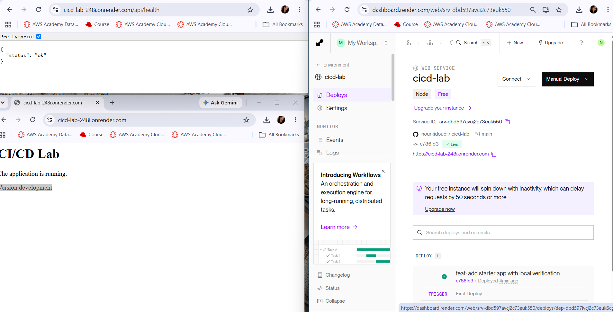
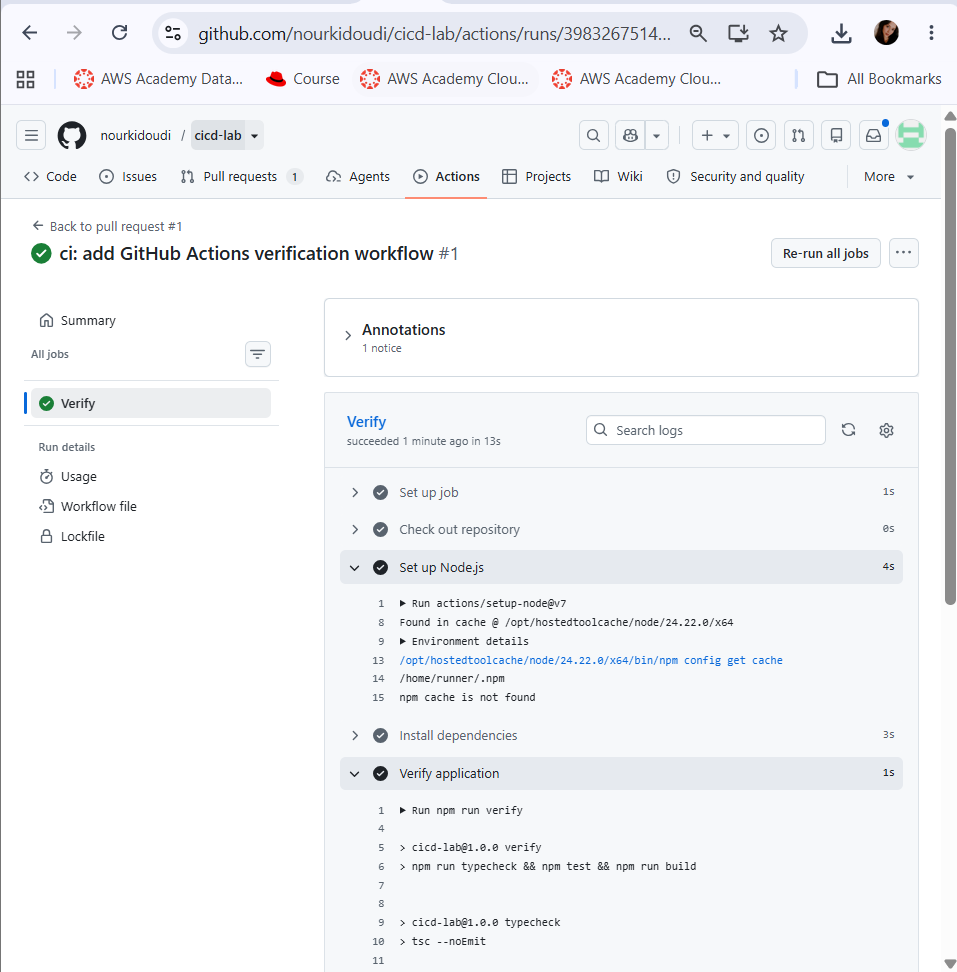
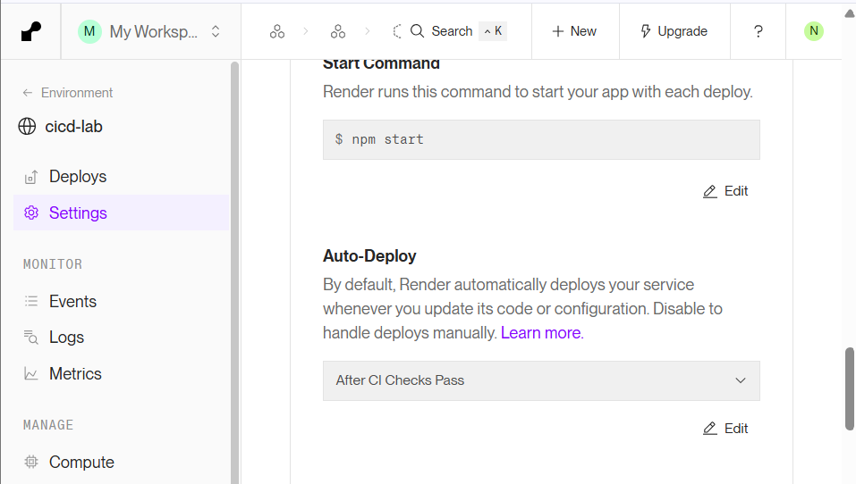
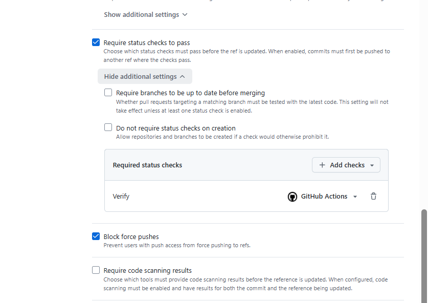
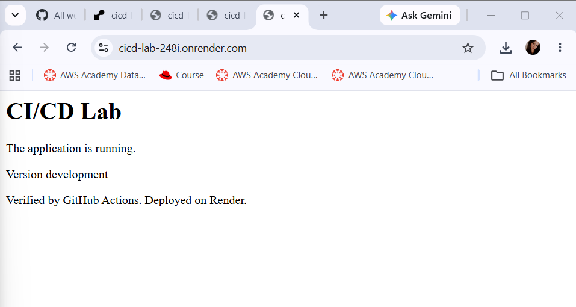
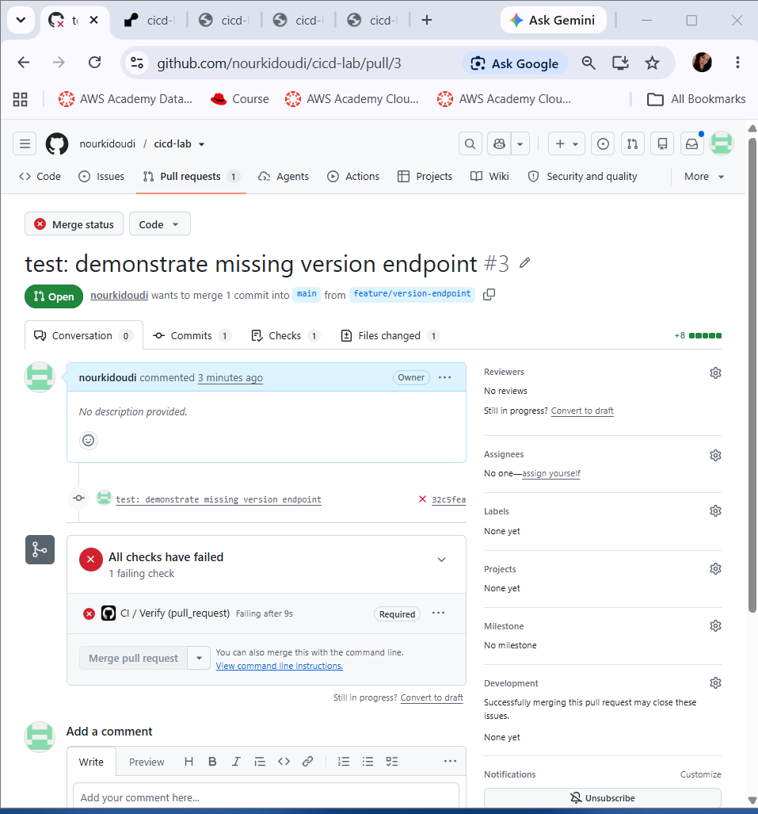
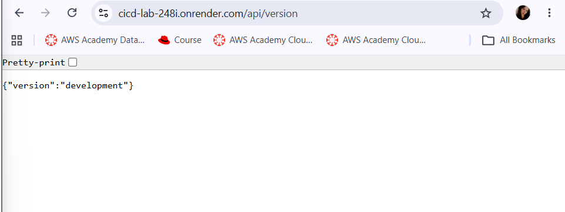
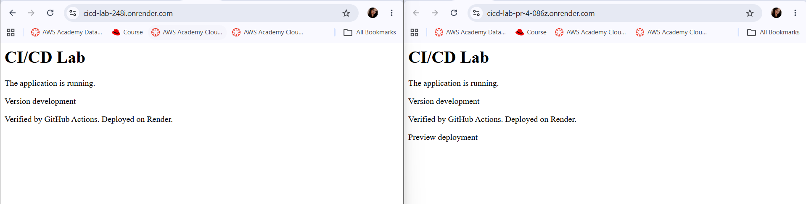

# cicd-lab : CI/CD avec GitHub Actions et Render

TP3 du Master DevOps & Cloud Computing (ISET Tozeur).
Une petite application Express/TypeScript, vérifiée automatiquement par **GitHub Actions** et déployée sur **Render** uniquement si la CI passe.

## Liens

- Dépôt GitHub : https://github.com/nourkidoudi/cicd-lab
- Production (Render) : https://cicd-lab-248i.onrender.com
- Health check : https://cicd-lab-248i.onrender.com/api/health
- Version : https://cicd-lab-248i.onrender.com/api/version

## Application

| Route | Réponse |
|---|---|
| `/` | Page d'accueil HTML |
| `/api/health` | `{"status":"ok"}` (HTTP 200) |
| `/api/version` | `{"version":"development"}` (ou `APP_VERSION` si défini) |

## Scripts npm

| Commande | Rôle |
|---|---|
| `npm run dev` | Serveur de développement (`tsx watch`) |
| `npm run typecheck` | Vérification des types (`tsc --noEmit`) |
| `npm test` | Tests (`node --test`) |
| `npm run build` | Compilation TypeScript vers `dist/` |
| `npm start` | Lance `dist/server.js` |
| `npm run verify` | typecheck + test + build, enchaînés |

## Lancer en local

```bash
node --version   # Node.js 24 requis
npm ci
npm run dev      # http://localhost:3000
npm run verify
```

## Pipeline CI/CD

```
Branche feature -> Pull request vers main -> GitHub Actions (Verify)
                                                 |
                      Verify rouge : merge bloqué (ruleset "Protect main")
                      Verify vert  : merge possible
                                                 |
                              Merge dans main -> nouveau run Verify
                                                 |
                      Render déploie (Auto-Deploy : After CI Checks Pass)
```

- **Workflow** : `.github/workflows/ci.yml` (job `Verify`, Node 24, `npm ci` puis `npm run verify`).
- **Ruleset** `Protect main` : pull request obligatoire, check `Verify` obligatoire, bypass vide.
- **Render** : Build `npm ci && npm run build`, Start `npm start`, Health Check `/api/health`, Auto-Deploy `After CI Checks Pass`, Pull Request Previews activés.

## Captures d'écran

| Étape | Capture |
|---|---|
| Premier déploiement Render + `/api/health` |  |
| Job Verify réussi dans GitHub Actions |  |
| Auto-Deploy : After CI Checks Pass |  |
| Ruleset Protect main |  |
| Page d'accueil mise à jour |  |
| PR avec Verify en échec et merge bloqué |  |
| Réponse de `/api/version` |  |
| Preview vs production |  |

## Rapport

Voir [REPORT.md](REPORT.md).
